# Decal { #decal }
!!! quote "注意事項"
    註：模板版本為vao0822。預覽圖左側為斜向下視角，右側正對法線，也就是地編視角；判斷形狀請以水平線為參考，垂直線是點透視，可能讓物件看起來傾斜。

TABLES · 29 項

  

    
    <input class="ts-search__input" type="search" autocomplete="off" spellcheck="false" placeholder="搜索名稱或引用值…" aria-label="搜索清單">
    <kbd class="ts-search__kbd">Ctrl K</kbd>
  

  
共 29 項 · 可搜名稱與引用值

*[模板]: 物件在 `template = …` 裡引用的名字，地編裡按這個名字找它

## 正常物件 21 項 { #normal }

| 預覽 | 名稱 | 備註 |
| --- | --- | --- |
|   | 停機坪 template = heliped |  |
| 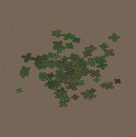 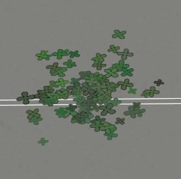 | 三葉草草坪 template = clover |  |
| 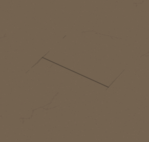  | 人行道 template = pavement |  |
| 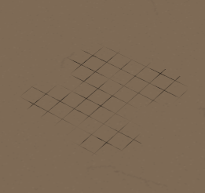 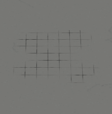 | 人行道 template = pavement_tile1 | 正方形磚塊紋理 |
| 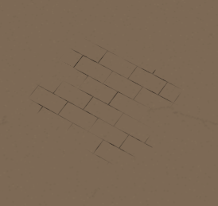 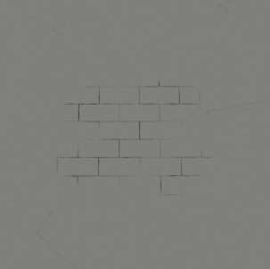 | 屋頂 template = roof_tile1 | 長方形磚塊紋理 |
| 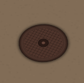 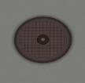 | 檢修井井蓋 template = manhole |  |
| 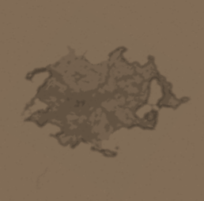 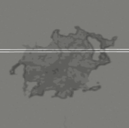 | 一號裂紋 template = cracks_1 |  |
| 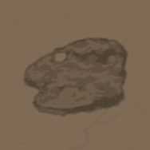 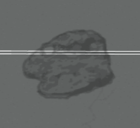 | 二號裂紋 template = cracks_2 |  |
| 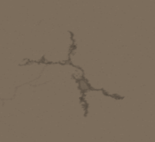 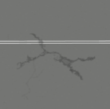 | 三號裂紋 template = cracks_3 |  |
|  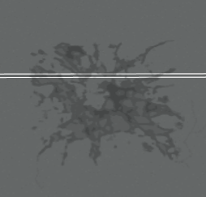 | 四號裂紋 template = cracks_4 |  |
| 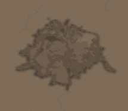 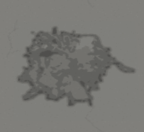 | 五號裂紋 template = cracks_5 |  |
| 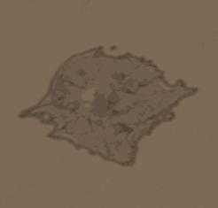 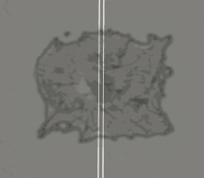 | 六號裂紋 template = cracks_6 |  |
| 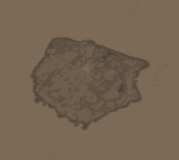 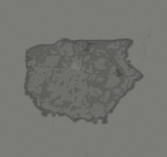 | 七號裂紋 template = cracks_7 |  |
| 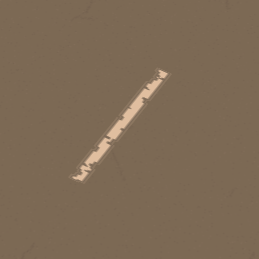 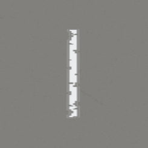 | 停車標線 template = parking_line |  |
| 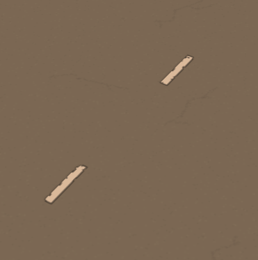 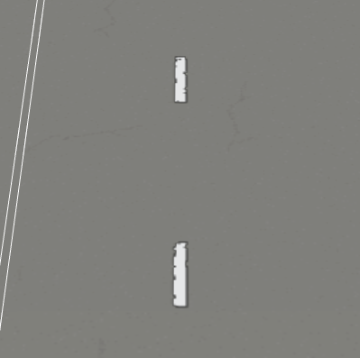 | 道路標線 template = roadline |  |
|  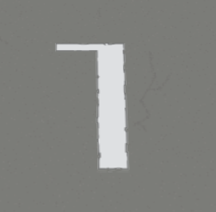 | 停止標線 template = stop_line |  |
| 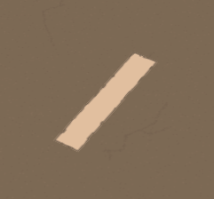 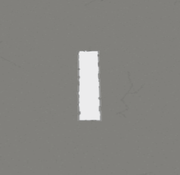 | 二號停止標線 template = stop_line2 |  |
| 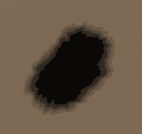 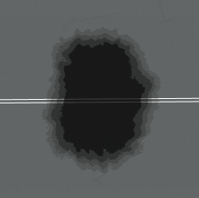 | 燒焦地面 template = burned_ground |  |
|  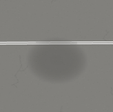 | 一號基礎樹蔭 template = tree_ground_base1 | 一個淡黑色圓 |
| 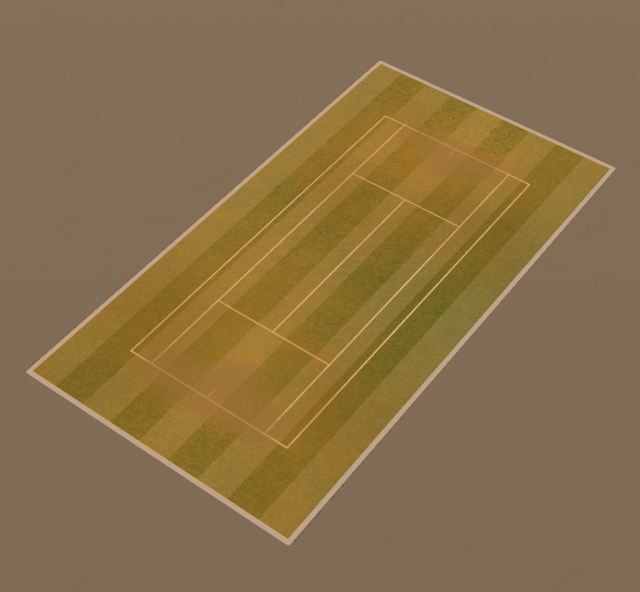 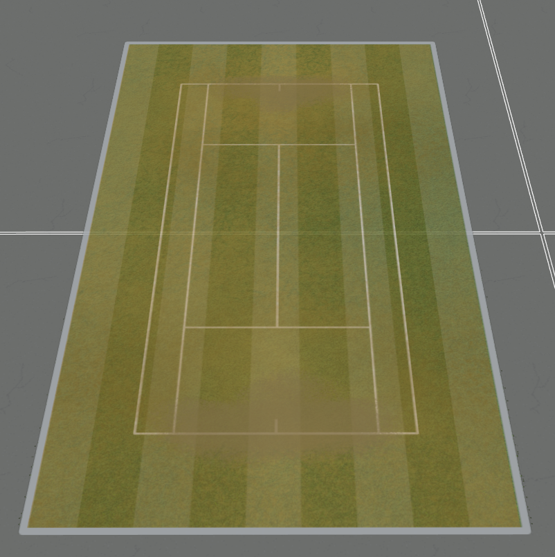 | 一大片網球場 template = tennis_court |  |
| 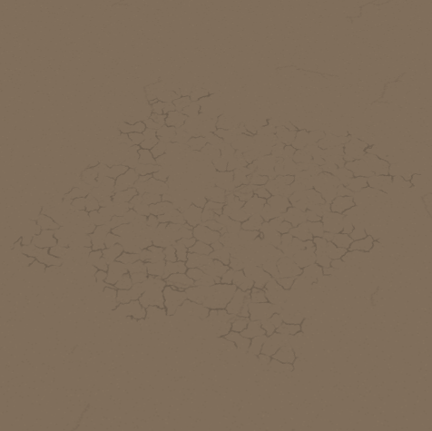 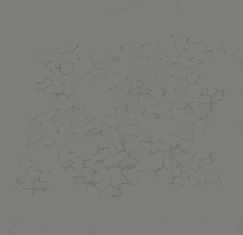 | 龜裂的地面 template = dry_terrain |  |

## 有問題的物件 8 項 { #broken }

這幾件東西本身或者它的渲染有問題——名字和引用值能對上，但擺進地圖裡就是下面這個樣子，別當成正常效果去找。

| 預覽 | 名稱 | 備註 |
| --- | --- | --- |
|  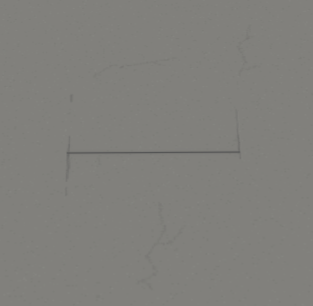 | 花 template = flower | 材質引用錯誤，引用成了人行道的 |
|  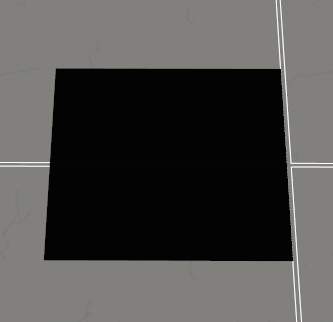 | 燒焦地面面 template = burned_groundd | 渲染錯誤 |
|   | 燒焦地面面2 template = burned_groundd2 | 渲染錯誤 |
|   | 燒焦地面面3 template = burned_groundd3 | 渲染錯誤 |
|  | 樹蔭 template = tree_grate | 渲染不完整 |
| 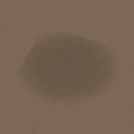 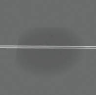 | 二號基礎樹蔭 template = tree_ground_base2 | 渲染不完整 |
| 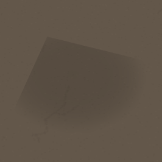 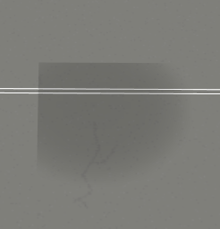 | 三號基礎樹蔭 template = tree_ground_base3 | 渲染不完整 |
| 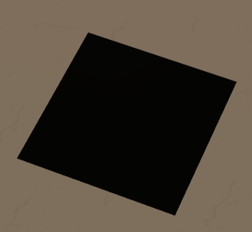  | 神秘棕色方塊 template = ee_8 | 渲染錯誤 實際上是 KILROY WAS HERE 彩蛋圖標 在地圖文件內放了 ee_8 才會正常顯示  |
